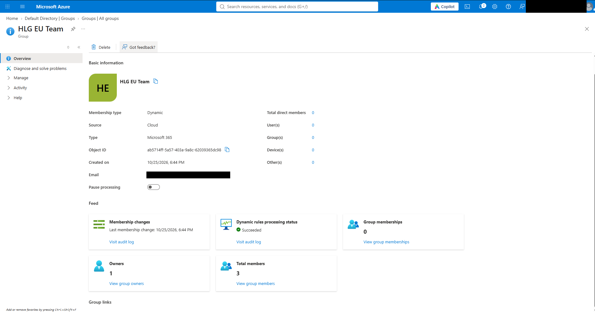
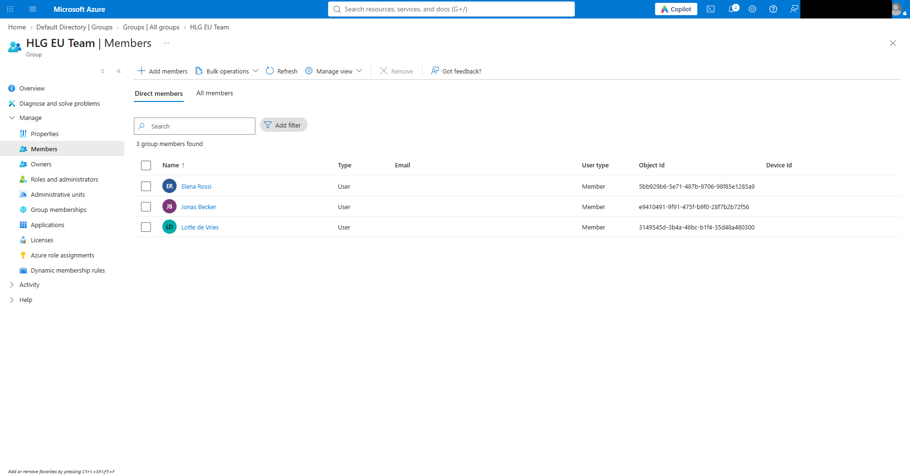
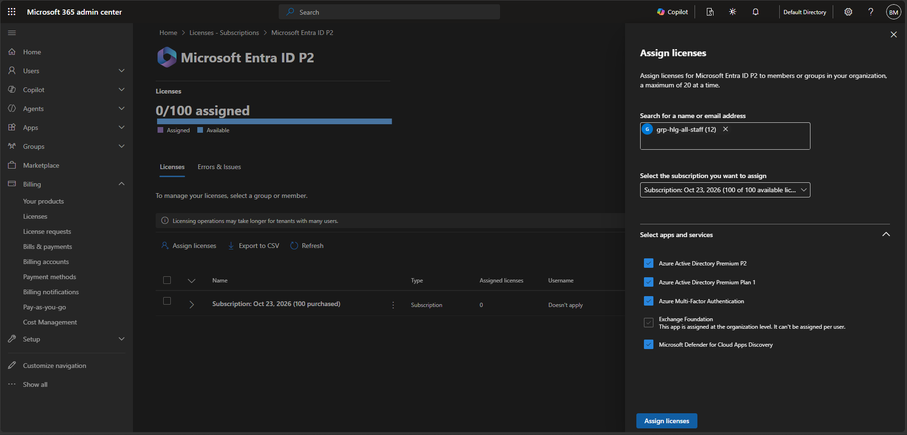
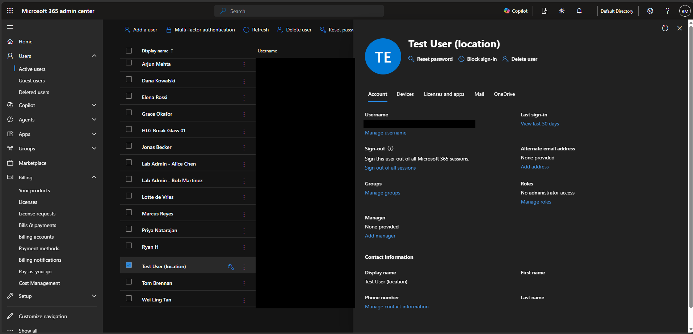
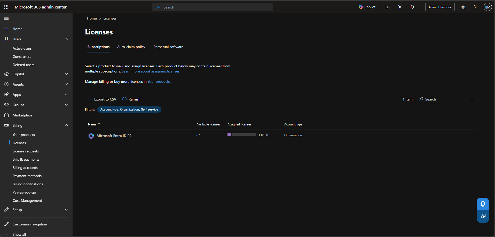
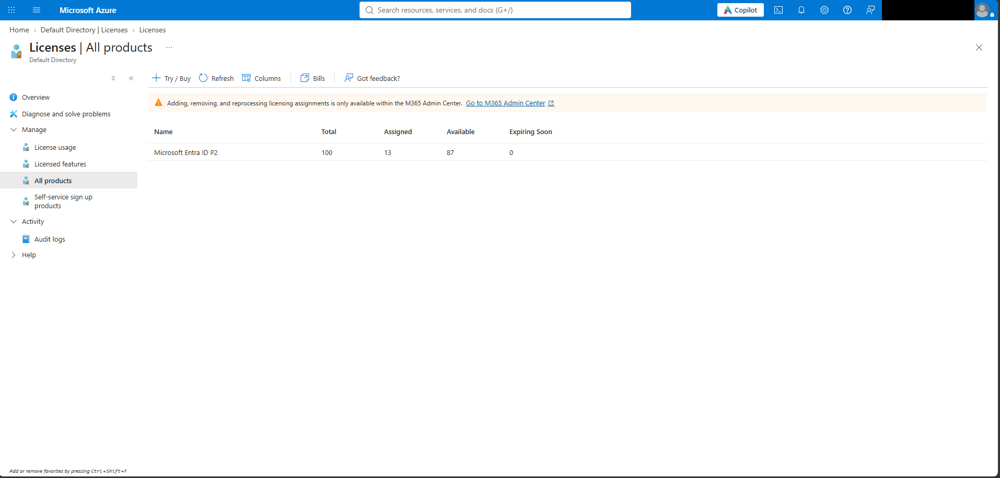

# Lab 01: Halsted Staff Identities, Licensing, Guests, SSPR and Conditional Access

**Status:** In progress (Tasks 1–5 done, working on Task 6) · **Date(s):** Oct 23, 2026– · **Time spent:** - · **Cost (Cost analysis):** -

Lab guide: [labs/01-identities-and-conditional-access.md](../labs/01-identities-and-conditional-access.md) · Screenshots: `screenshots/lab-01/`

## What I built
<!-- 3-5 bullets in my own words, written after finishing the lab. -->
-

## Evidence
<!-- When a screenshot is committed, replace its path with an embed, e.g.
     
     and set Status to Done. Redact first: docs/screenshot-guide.md -->
| Checkpoint | What it proves | Screenshot | Status |
|---|---|---|---|
| 01-01 | Marcus's profile showing job info, usage location and manager |   | Done |
| 01-02 | Bulk operation results (Path A) or the script output (Path B) |   | Done |
| 01-03 | The Deleted users blade with Dana selected for restore |   | Done |
| 01-04 | `grp-hlg-eu-ops` dynamic rule and its members |   | Partial: shows the 4c Microsoft 365 group. `grp-hlg-eu-ops` rule screenshot still to capture |
| 01-05 | The group Licenses blade showing the usage-location error, then cleared |     | Partial: the usage-location error itself not yet captured |
| 01-06 | The guest's profile showing User type: Guest and the #EXT# UPN | `screenshots/lab-01/01-06-guest-user.png` | Pending |
| 01-07 | The SSPR Properties blade scoped to the pilot group, plus the reset success page | `screenshots/lab-01/01-07-sspr.png` | Pending |
| 01-08 | The CA policy list, plus Priya's sign-in log Conditional Access tab | `screenshots/lab-01/01-08-conditional-access.png` | Pending |

## Commands I want to remember
```bash
```

## What broke and how I fixed it
- **Symptom:** The lab guide says to assign licenses from Entra ID → Licenses → All products, but that blade has no Assign button.
  **Cause:** Microsoft moved license assignment out of the Entra portal. The blade now says "Adding, removing, and reprocessing licensing assignments is only available within the M365 Admin Center."
  **Fix:** Assigned Entra ID P2 to `grp-hlg-all-staff` from the Microsoft 365 admin center (Billing → Licenses → Microsoft Entra ID P2 → Assign licenses). The Entra blade still shows the result (13/100 assigned).
- **Symptom:**
  **Cause:**
  **Fix:**

## Exam tips in my own words
-

## Knowledge check score
- __ / 5 first try. Misses:

## Questions to follow up
-