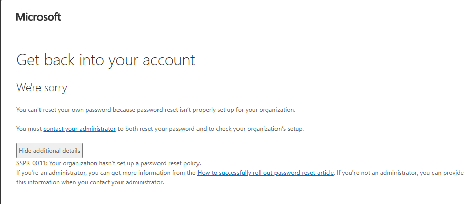
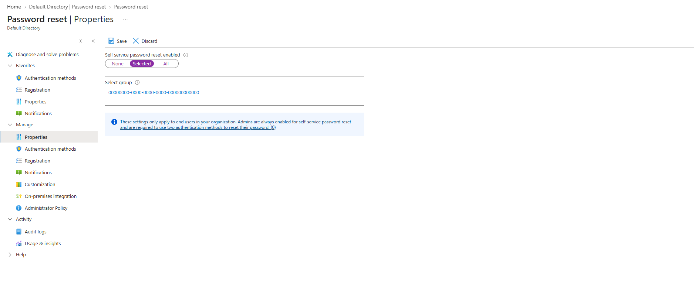
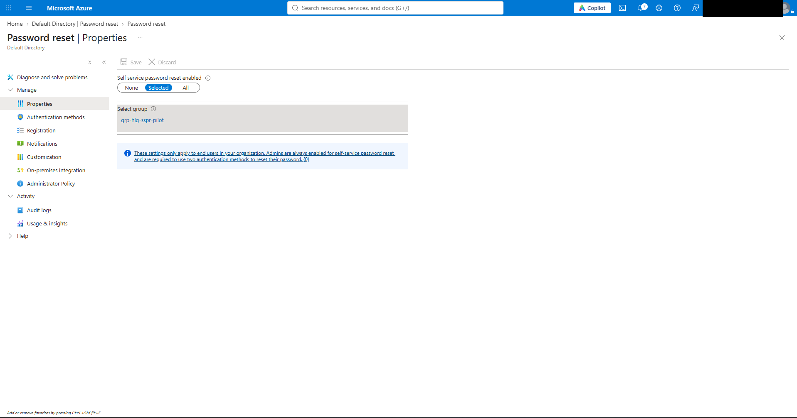
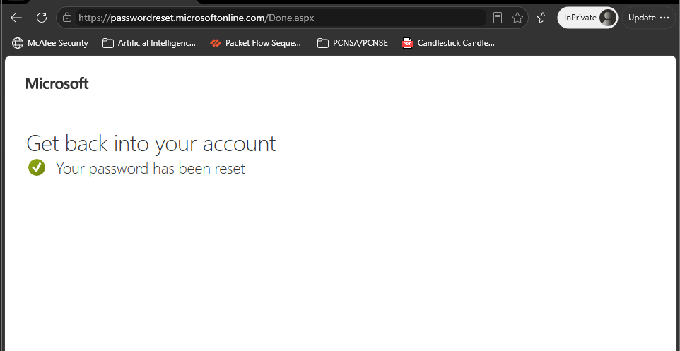
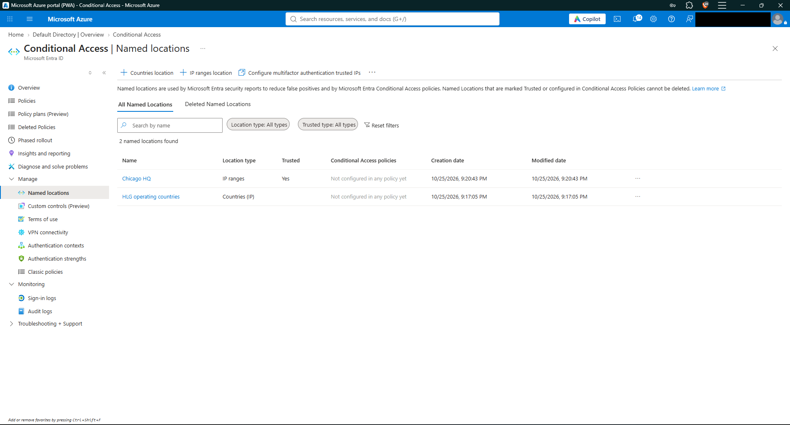
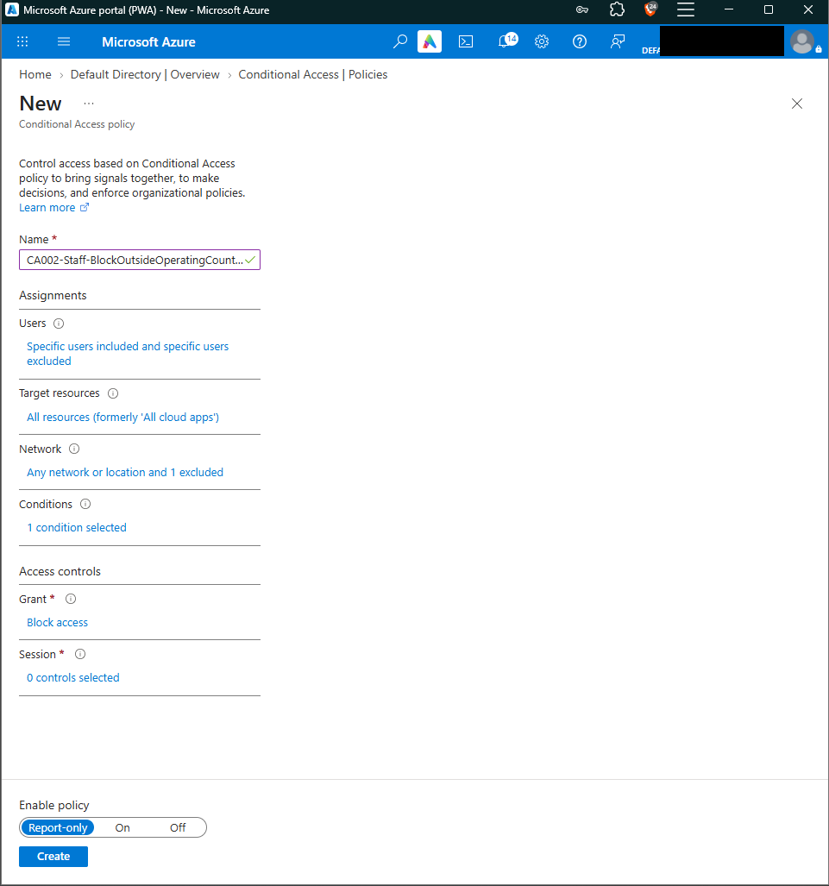
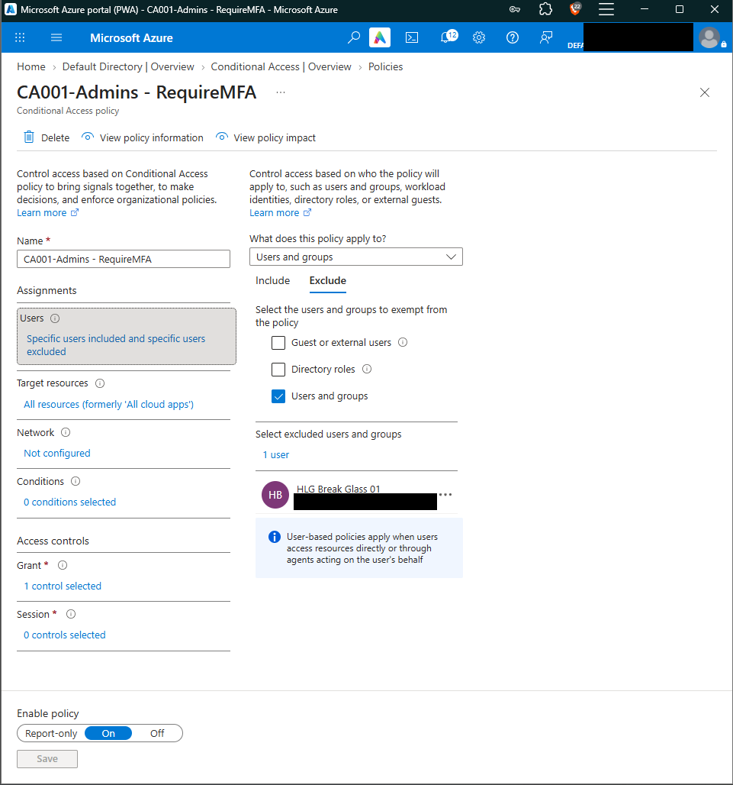
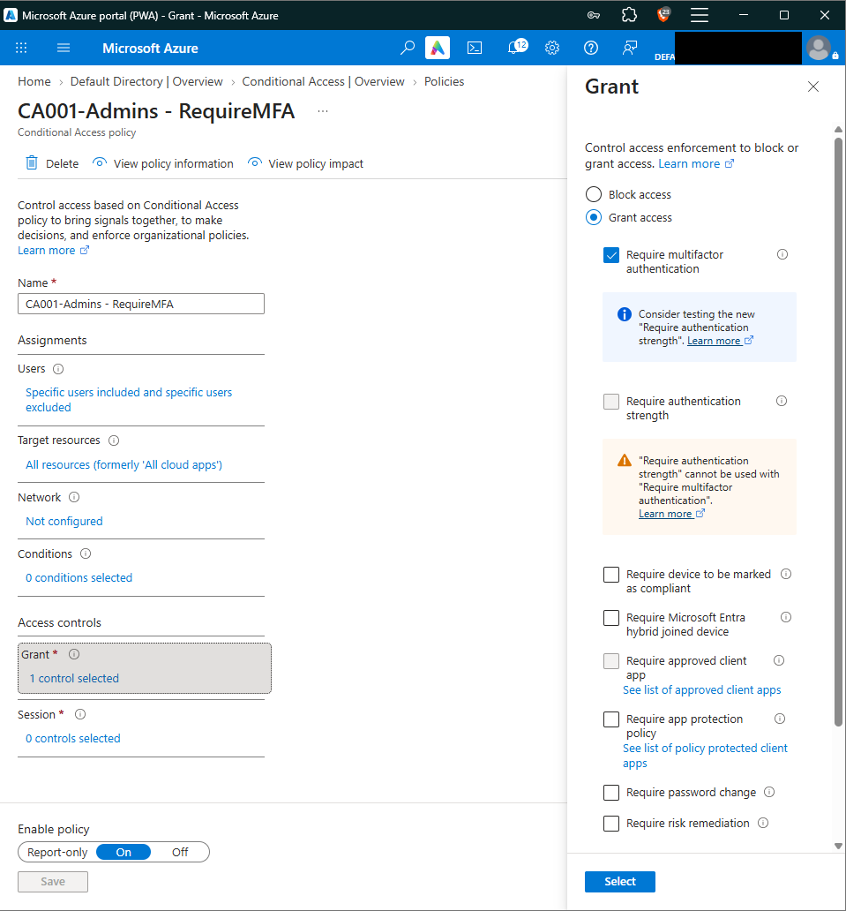

# Lab 01: Halsted Staff Identities, Licensing, Guests, SSPR and Conditional Access

**Status:** Complete (screenshots still pending for 01-04, 01-05, 01-06 and 01-08; see table) · **Date(s):** Oct 23–25, 2026 · **Time spent:** - · **Cost (Cost analysis):** -

Lab guide: [labs/01-identities-and-conditional-access.md](../labs/01-identities-and-conditional-access.md) · Screenshots: `screenshots/lab-01/`

## What I built
<!-- 3-5 bullets in my own words, written after finishing the lab. -->
- Halsted staff accounts: a break-glass account and two staff created by hand, then eight more from a CSV bulk import (portal Path A). I practiced block sign-in, password reset, revoking sessions, and deleting and restoring a user.
- Assigned security groups for each team, dynamic groups by department (EU Ops, APAC Ops, all staff), and a dynamic Microsoft 365 group for contrast. Priya owns `grp-hlg-network-ops`, so she can manage its members without an admin role.
- Group-based licensing: Entra ID P2 assigned to `grp-hlg-all-staff`, plus a test user with no usage location to reproduce the classic license failure.
- B2B guest access for a partner contractor, with guest invites restricted to admins.
- SSPR scoped to a pilot group and tested end-to-end as Lotte: registered the Authenticator app, then reset her password at aka.ms/sspr.
- Conditional Access: named locations (Chicago HQ as a trusted IP, plus HLG operating countries), admin MFA with a break-glass exclusion, and a report-only block for sign-ins outside operating countries.

## Evidence
<!-- When a screenshot is committed, replace its path with an embed, e.g.
     
     and set Status to Done. Redact first: docs/screenshot-guide.md -->
| Checkpoint | What it proves | Screenshot | Status |
|---|---|---|---|
| 01-01 | Marcus's profile showing job info, usage location and manager |   | Done |
| 01-02 | Bulk operation results (Path A) or the script output (Path B) |   | Done |
| 01-03 | The Deleted users blade with Dana selected for restore |   | Done |
| 01-04 | `grp-hlg-eu-ops` dynamic rule and its members |   | Partial: shows the 4c Microsoft 365 group. `grp-hlg-eu-ops` rule screenshot still to capture |
| 01-05 | The group Licenses blade showing the usage-location error, then cleared |     | Partial: the usage-location error itself not yet captured |
| 01-06 | The guest's profile showing User type: Guest and the #EXT# UPN | `screenshots/lab-01/01-06-guest-user.png` | Pending |
| 01-07 | The SSPR Properties blade scoped to the pilot group, plus the reset success page |     | Done |
| 01-08 | The CA policy list, plus Priya's sign-in log Conditional Access tab |     | Partial: policy list and Priya's sign-in log still to capture |

## Commands I want to remember
```bash
```

## What broke and how I fixed it
- **Symptom:** The lab guide says to assign licenses from Entra ID → Licenses → All products, but that blade has no Assign button.
  **Cause:** Microsoft moved license assignment out of the Entra portal. The blade now says "Adding, removing, and reprocessing licensing assignments is only available within the M365 Admin Center."
  **Fix:** Assigned Entra ID P2 to `grp-hlg-all-staff` from the Microsoft 365 admin center (Billing → Licenses → Microsoft Entra ID P2 → Assign licenses). The Entra blade still shows the result (13/100 assigned).
- **Symptom:** Lotte got `SSPR_0011: Your organization hasn't set up a password reset policy`, and she signed in without being asked to register security info.
  **Cause:** SSPR was set to **Selected**, but the group was an empty ID (`00000000-0000-0000-0000-000000000000`), so the policy applied to no one. The portal accepts this without a warning.
  **Fix:** Selected `grp-hlg-sspr-pilot` again, saved, and waited about 15 minutes. Lotte was then prompted to register, and the reset succeeded.
- **Symptom:** When building CA002, "HLG operating countries" wasn't in the location picker. The only option was "Multifactor authentication trusted IPs".
  **Cause:** I skipped step 8b. The picker only lists named locations that already exist.
  **Fix:** Created the `HLG operating countries` (Countries) and `Chicago HQ` (trusted IP range) named locations, then excluded the countries location in CA002.

## Exam tips in my own words
- A policy that is **On** but scoped to nothing does nothing. When a user is "not covered," check the scope first.
- Users and network locations in Conditional Access are include **minus** exclude, so "Any location, exclude operating countries" means "everywhere else."
- Start a blocking policy in **Report-only**, and always exclude break-glass before turning anything On.
- License assignment has moved to the M365 admin center, but the Entra portal still shows counts. Group-based licensing fails when a user has no **usage location**.

## Knowledge check score
- __ / 5 first try. Misses:

## Questions to follow up
-