# Lab 02: Governance: Management Groups, Policy, Tags, Locks and Costs

**Status:** In progress (Tasks 1–2, 3a and 3b done; 3c tags next) · **Date(s):** Oct 26, 2026– · **Time spent:** - · **Cost (Cost analysis):** -

Lab guide: [labs/02-governance-policy-locks-costs.md](../labs/02-governance-policy-locks-costs.md) · Screenshots: `screenshots/lab-02/`

## What I built
<!-- 3-5 bullets in my own words, written after finishing the lab. -->
-

## Evidence
<!-- When a screenshot is committed, replace its path with an embed, e.g.
     
     and set Status to Done. Redact first: docs/screenshot-guide.md -->
| Checkpoint | What it proves | Screenshot | Status |
|---|---|---|---|
| 02-01 | The expanded MG tree with your subscription under `mg-hlg-landingzones` | 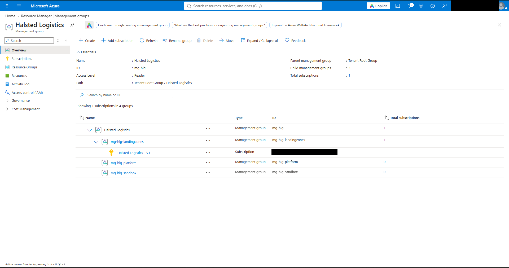 | Done |
| 02-02 | Resource providers filtered to Microsoft.App, plus Usage + quotas | 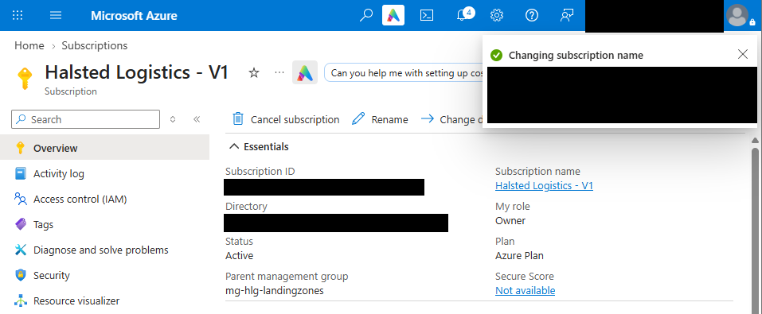 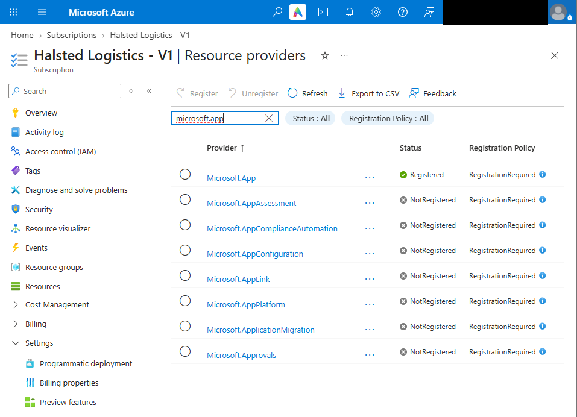 | Partial: Usage + quotas still to capture |
| 02-03 | Resource groups list showing the tag columns | 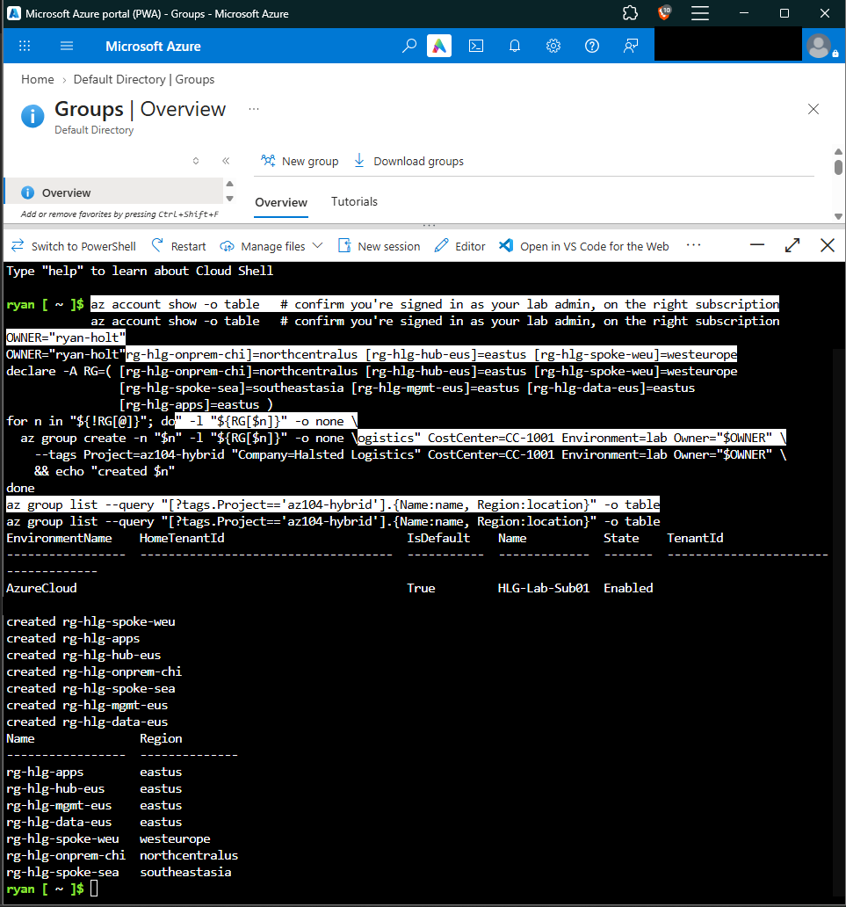 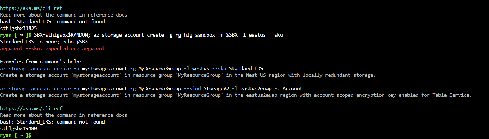 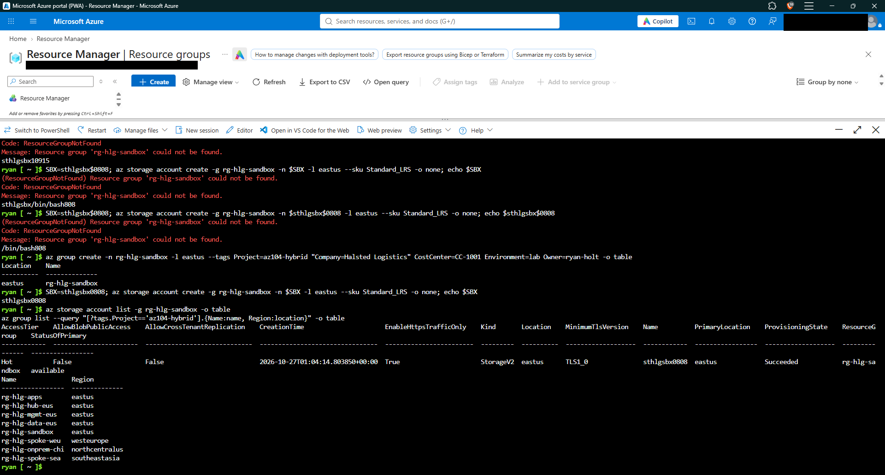 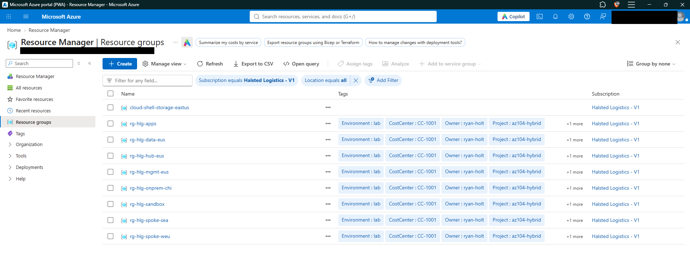 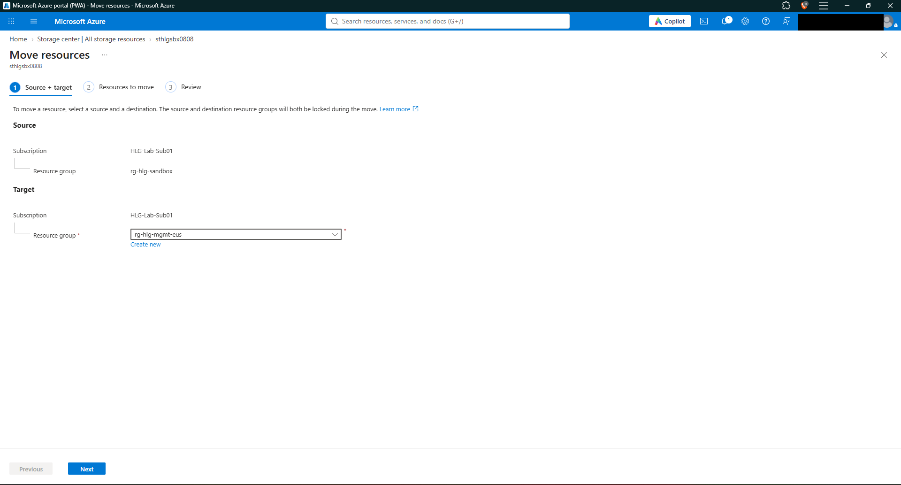 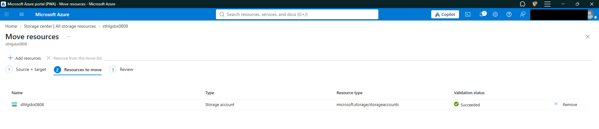 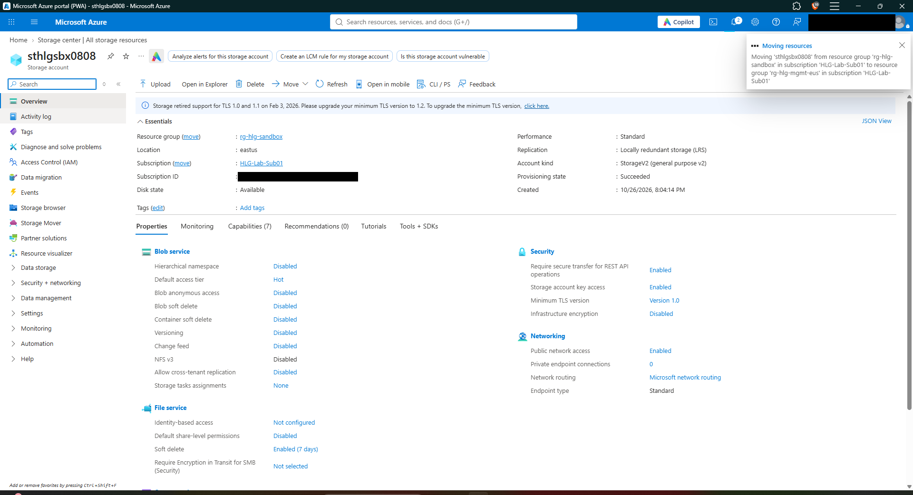 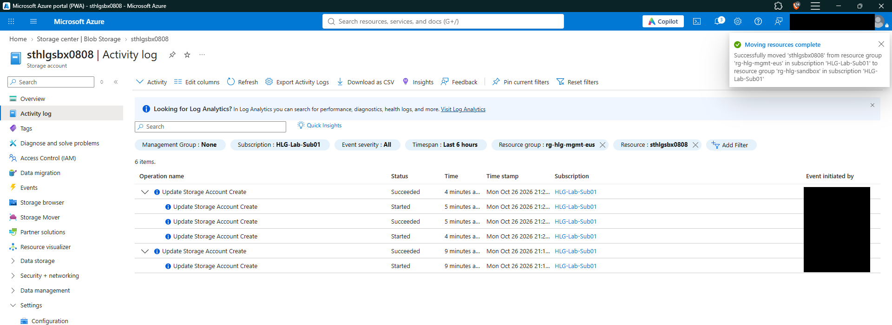 | Done for 3a and 3b; 3c tag steps still to do |
| 02-04 | (a) the RequestDisallowedByPolicy error, (b) the initiative assignment's compliance page, (c) `rg-hlg-untagged` auto-tagged by Modify | `screenshots/lab-02/02-04-policy-*.png` | Pending |
| 02-05 | The *Access keys* error caused by the ReadOnly lock | `screenshots/lab-02/02-05-readonly-lock.png` | Pending |
| 02-06 | Both budgets, plus the Advisor configuration page | `screenshots/lab-02/02-06-budgets-advisor.png` | Pending |

## Commands I want to remember
```bash
# Create a tagged resource group (region is required)
az group create -n rg-hlg-sandbox -l eastus --tags Project=az104-hybrid "Company=Halsted Logistics" CostCenter=CC-1001 Environment=lab Owner=ryan-holt -o table

# List only this project's groups
az group list --query "[?tags.Project=='az104-hybrid'].{Name:name, Region:location}" -o table

# Storage account with a random, unique name
SBX=sthlgsbx$RANDOM; az storage account create -g rg-hlg-sandbox -n $SBX -l eastus --sku Standard_LRS -o none; echo $SBX
```

## What broke and how I fixed it
- **Symptom:** `argument --sku: expected one argument`, then `bash: Standard_LRS: command not found`.
  **Cause:** The command wrapped onto two lines when I copied it from the lab guide. In Bash, a line break ends a command unless the line ends with `\`, so `Standard_LRS` ran as its own command.
  **Fix:** Pasted the command as one line.
- **Symptom:** `ResourceGroupNotFound` for `rg-hlg-sandbox`.
  **Cause:** The sandbox group is a separate step from the loop, and I hadn't created it yet. My first `az group create` also failed because I left out the region (`-l`).
  **Fix:** `az group create -n rg-hlg-sandbox -l eastus --tags ...`
- **Symptom:** The storage account name came out as `sthlgsbx/bin/bash808`.
  **Cause:** I typed `$0808`. `$` means "insert a variable," and `$0` is the shell's own name (`/bin/bash`).
  **Fix:** Used plain digits (`sthlgsbx0808`) or `$RANDOM`. Storage account names are 3–24 characters, lowercase letters and numbers only, and globally unique.

## Exam tips in my own words
-

## Knowledge check score
- __ / 5 first try. Misses:

## Questions to follow up
-